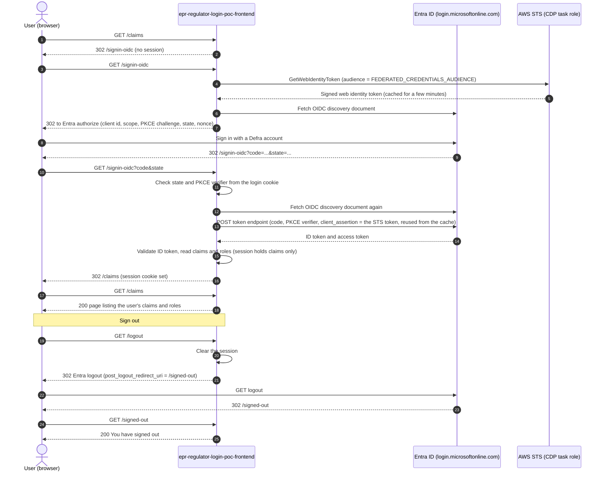

# epr-regulator-login-poc-frontend

[](https://sonarcloud.io/summary/new_code?id=DEFRA_epr-regulator-login-poc-frontend)
[](https://sonarcloud.io/summary/new_code?id=DEFRA_epr-regulator-login-poc-frontend)
[](https://sonarcloud.io/summary/new_code?id=DEFRA_epr-regulator-login-poc-frontend)

Core delivery platform Node.js Frontend Template.

- [Requirements](#requirements)
  - [Node.js](#nodejs)
- [Server-side Caching](#server-side-caching)
- [Redis](#redis)
- [Local Development](#local-development)
  - [Setup](#setup)
  - [Development](#development)
  - [Production](#production)
  - [Npm scripts](#npm-scripts)
  - [Update dependencies](#update-dependencies)
  - [Formatting](#formatting)
    - [Windows prettier issue](#windows-prettier-issue)
- [Docker](#docker)
  - [Development image](#development-image)
  - [Production image](#production-image)
  - [Docker Compose](#docker-compose)
  - [Dependabot](#dependabot)
  - [SonarCloud](#sonarcloud)
- [Licence](#licence)
  - [About the licence](#about-the-licence)

## Requirements

### Node.js

Please install Node Version Manager [nvm](https://github.com/creationix/nvm)

To use the correct version of Node.js for this application, via nvm:

```bash
cd epr-regulator-login-poc-frontend
nvm use
```

## Server-side Caching

We use Catbox for server-side caching. By default the service will use CatboxRedis when deployed and CatboxMemory for
local development.
You can override the default behaviour by setting the `SESSION_CACHE_ENGINE` environment variable to either `redis` or
`memory`.

Please note: CatboxMemory (`memory`) is _not_ suitable for production use! The cache will not be shared between each
instance of the service and it will not persist between restarts.

## Redis

Redis is an in-memory key-value store. Every instance of a service has access to the same Redis key-value store similar
to how services might have a database (or MongoDB). All frontend services are given access to a namespaced prefixed that
matches the service name. e.g. `my-service` will have access to everything in Redis that is prefixed with `my-service`.

If your service does not require a session cache to be shared between instances or if you don't require Redis, you can
disable setting `SESSION_CACHE_ENGINE=false` or changing the default value in `src/config/index.js`.

## Proxy

We are using forward-proxy which is set up by default. Services are automatically configured with the proxy environment variables when deployed.

Node.js 24 uses these variables to route outbound HTTP(S) requests through the proxy:

NODE_USE_ENV_PROXY=1
HTTPS_PROXY=...
NO_PROXY=...

No additional proxy configuration is required in the service.

## Local Development

### Setup

Install application dependencies:

```bash
npm install
```

### Git hooks

Install git hooks (optional)

```bash
npm run git:hooks
```

### Development

To run the application in `development` mode run:

```bash
npm run dev
```

#### Development over HTTPS (local sign-in)

The Entra ID app registration only has `https://localhost:3000` redirect URIs, and the app itself only serves HTTP. To sign in locally run:

```bash
export ENTRA_ID_CLIENT_SECRET='<secret>'
npm run dev:https
```

This starts the app on port 3001 and an HTTPS proxy on port 3000 (`scripts/dev-https.mjs`), then open `https://localhost:3000` and accept the self-signed certificate warning. It creates the certificate on first run in `node_modules/.cache/local-https` and needs `openssl`. It sets `PORT` and `APP_BASE_URL` for the run. For local use only, CDP does not use it. Also set `ENTRA_ID_CREDENTIAL_TYPE=secret`, `ENTRA_ID_AUTHORITY`, `ENTRA_ID_CLIENT_ID` and `ENTRA_ID_API_SCOPE` in `.env` (see the Entra ID section below).

### Production

To mimic the application running in `production` mode locally run:

```bash
npm start
```

### Npm scripts

All available Npm scripts can be seen in [package.json](./package.json)
To view them in your command line run:

```bash
npm run
```

### Update dependencies

To update dependencies use [npm-check-updates](https://github.com/raineorshine/npm-check-updates):

> The following script is a good start. Check out all the options on
> the [npm-check-updates](https://github.com/raineorshine/npm-check-updates)

```bash
ncu --interactive --format group
```

### Formatting

#### Windows prettier issue

If you are having issues with formatting of line breaks on Windows update your global git config by running:

```bash
git config --global core.autocrlf false
```

## Docker

### Development image

> [!TIP]
> For Apple Silicon users, you may need to add `--platform linux/amd64` to the `docker run` command to ensure
> compatibility fEx: `docker build --platform=linux/arm64 --no-cache --tag epr-regulator-login-poc-frontend`

Build:

```bash
docker build --target development --no-cache --tag epr-regulator-login-poc-frontend:development .
```

Run:

```bash
docker run -p 3000:3000 epr-regulator-login-poc-frontend:development
```

### Production image

Build:

```bash
docker build --no-cache --tag epr-regulator-login-poc-frontend .
```

Run:

```bash
docker run -p 3000:3000 epr-regulator-login-poc-frontend
```

### Docker Compose

A local environment with:

- Floci (replacing Localstack) for AWS services (S3, SQS)
- Redis
- MongoDB
- This service.
- A commented out backend example.

```bash
docker compose up --build -d
```

### Dependabot

We have added an example dependabot configuration file to the repository. You can enable it by renaming
the [.github/example.dependabot.yml](.github/example.dependabot.yml) to `.github/dependabot.yml`

### SonarCloud

Instructions for setting up SonarCloud can be found in [sonar-project.properties](./sonar-project.properties).

## Licence

THIS INFORMATION IS LICENSED UNDER THE CONDITIONS OF THE OPEN GOVERNMENT LICENCE found at:

<http://www.nationalarchives.gov.uk/doc/open-government-licence/version/3>

The following attribution statement MUST be cited in your products and applications when using this information.

> Contains public sector information licensed under the Open Government license v3

### About the licence

The Open Government Licence (OGL) was developed by the Controller of Her Majesty's Stationery Office (HMSO) to enable
information providers in the public sector to license the use and re-use of their information under a common open
licence.

It is designed to encourage use and re-use of information freely and flexibly, with only a few conditions.

## Entra ID sign-in proof of concept (ELSP-486 / AMCR-540)

Sign in with Microsoft Entra ID, then `/claims` lists the claims held about the signed-in user (ID token claims, access token claims and app roles). Nothing else: no backend calls, no account lookup. Session holds claims only, never tokens.

| Path                                     | Auth      | What                                                |
| ---------------------------------------- | --------- | --------------------------------------------------- |
| `/`                                      | open      | sign-in button                                      |
| `/claims`                                | signed in | claims and roles                                    |
| `/signin-oidc`, `/logout`, `/signed-out` | -         | sign-in start/callback, Entra sign-out, return page |

| Variable                         | Notes                                                                                                                              |
| -------------------------------- | ---------------------------------------------------------------------------------------------------------------------------------- |
| `APP_BASE_URL`                   | public URL; redirect URI is `<base>/signin-oidc`, post-logout `<base>/signed-out`                                                  |
| `ENTRA_ID_AUTHORITY`             | `https://login.microsoftonline.com/<tenant id>`                                                                                    |
| `ENTRA_ID_CLIENT_ID`             | app registration                                                                                                                   |
| `ENTRA_ID_API_SCOPE`             | `api://<client id>/.default`; the roles section and the access token claims are read from the access token, which needs this scope |
| `ENTRA_ID_CREDENTIAL_TYPE`       | `federated` (default, CDP) or `secret` (local only)                                                                                |
| `FEDERATED_CREDENTIALS_AUDIENCE` | audience of the federated credential (default `epr-regulator-login-poc-frontend`)                                                  |
| `ENTRA_ID_CLIENT_SECRET`         | local only                                                                                                                         |
| `SESSION_COOKIE_PASSWORD`        | 32+ chars. A CDP **secret** (portal, Secrets tab), never in cdp-app-config                                                         |

Non-secret values go in `cdp-app-config/services/epr-regulator-login-poc-frontend/dev/epr-regulator-login-poc-frontend.env` (or `defaults.env` for all environments). Redeploy after changing config or secrets.

Needs on the Entra side: redirect URI, post-logout URI, and on CDP a federated credential (issuer `CDP_JWT_ISSUER`, subject = the task role ARN, audience as above). `login.microsoftonline.com` and `.amazonaws.com` (STS) are on the CDP proxy default allow-list according to the CDP proxy docs. Whether the STS call really goes through the proxy is not confirmed until the app is deployed.

### Login process

The app is the OIDC client (authorization code flow with PKCE, `@defra/hapi-auth-oidc`). On CDP it proves its identity to Entra ID with a federated credential (a short-lived AWS STS token) instead of a client secret. The session holds claims only, never tokens.



If the code exchange or the state check fails, the app shows a 401 "Sign in failed" page. If Entra cannot be reached when sign-in starts (discovery or STS fails), it shows a 503 "Sign in unavailable" page. If the Entra settings are missing, `/signin-oidc` shows a 503 "Sign in is not configured" page. The STS client may swallow an STS error, in which case the failure only shows at the token exchange as a 401. Locally (`ENTRA_ID_CREDENTIAL_TYPE=secret`) the STS steps are skipped and the token request sends `client_secret` instead of `client_assertion`.
