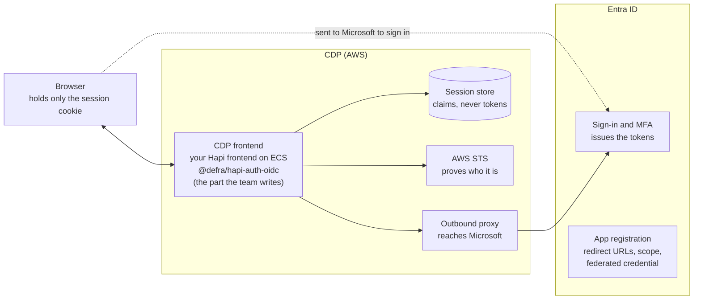
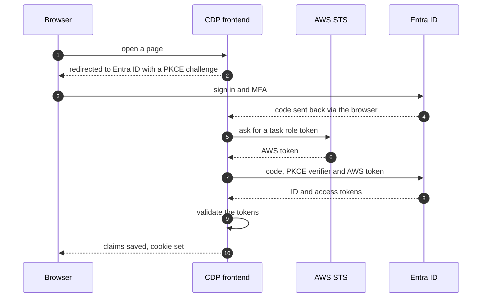

# Entra ID sign-in on a CDP frontend: high-level design

This answers spike questions 1 to 3 of AMCR-540: the design for Entra ID sign-in on a CDP frontend (Q1), the code to build it from (Q2), and how the service proves its own identity to Entra ID (Q3). Regulators sign in with Defra's Entra ID using the authorization code flow with PKCE, and on CDP the service proves who it is with a federated credential from AWS instead of a client secret.

The design follows the proof of concept on the `elsp-486-entra-claims-poc` branch of `epr-regulator-login-poc-frontend`. That has only been tested against a fake Entra ID and a fake AWS STS. Authorisation (app roles, security groups, giving and removing access) is out of scope here; it belongs to the later spike questions and AMCR-541.

## Decisions

### Q2: build on `@defra/hapi-auth-oidc`

Use CDP's `@defra/hapi-auth-oidc` library (version 0.6.1 in the proof of concept). It runs the sign-in flow, PKCE and token checks, and supports a federated credential through its `WebIdentityTokenProvider`. `waste-disposal-fee-frontend` already uses it with a federated credential on CDP, so it is the reference app.

| Candidate | Decision |
| --- | --- |
| `@defra/hapi-auth-oidc` (CDP) | **Chosen.** Supports a federated credential (AWS STS) on CDP and a client secret for local development |
| `@defra/hapi-oidc-auth` (pesticides team) | Not chosen. Client secret only: no AWS STS or federated credential support |
| `epr-frontend` `src/server/auth/plugins/entra-id.js` (Re-Ex) | Not chosen. Re-Ex's own code, not a shared library, and it uses a client secret |

> **Watch the names.** `@defra/hapi-auth-oidc` and `@defra/hapi-oidc-auth` differ only in word order, and the ticket itself warns they are easily confused. Only the first uses AWS STS: version 0.6.1 depends on `@aws-sdk/client-sts` and calls `GetWebIdentityToken` in `src/providers/web-identity.js`. `@defra/hapi-oidc-auth` 0.4.0 has no AWS dependency and requires a `clientSecret`. Always write the full package name.

### Q3: a federated credential, not a client secret

On CDP the service asks AWS STS for a short-lived token for its ECS task role and sends it to Entra ID as `client_assertion` in place of a client secret. Entra ID trusts the token because the app registration holds a federated credential that names the STS issuer, the task role ARN and an agreed audience.

- **Why:** a client secret expires and has to be rotated; Re-Ex's production secret expired on 07/11/2026. A federated credential leaves nothing to store or rotate, and Microsoft recommends it.
- **Every CDP environment uses it,** including test and perf-test, which sign in against the `defradev` tenant.
- **Local development only** uses a short-lived client secret on the `defradev` registration, because a laptop has no AWS task role. It never goes into CDP.
- **The AWS side is already in place:** CDP has set up outbound identity federation, the `sts:GetWebIdentityToken` permission and the proxy allow-list globally, so nothing needs requesting.

## At a glance

The highlighted frontend is the only part the team writes. It reaches Entra ID through the CDP outbound proxy, and proves who it is with a token from AWS STS (the Q3 decision) instead of a stored secret.

## Components

Seven parts work together; only the frontend is code the team writes.

| Component | What it is | What it does in sign-in |
| --- | --- | --- |
| Regulator's browser | The regulator's own browser | Follows redirects between the frontend and Entra ID; holds only a session cookie, never tokens |
| CDP frontend | A Hapi app on AWS ECS Fargate (in the proof of concept, `epr-regulator-login-poc-frontend`) using `@defra/hapi-auth-oidc` | Starts sign-in, receives the code back, exchanges it for tokens, checks them and keeps the user's claims in the session |
| Session store | `@hapi/yar`, always stored server-side: Redis on CDP, memory locally | Keeps the user's claims between page loads; the tokens themselves are never stored |
| Entra ID | Defra's identity service: the `Defra` tenant for prod and ext-test, `defradev` for test, perf-test and local | Signs the regulator in (including MFA), then issues an ID token and an access token |
| App registration | Entra ID's record of the service | Holds the client ID, the allowed redirect URLs, the API scope and the federated credential |
| AWS STS | AWS's token service, called with the ECS task role | Gives the frontend a short-lived token that proves which service it is, so no client secret is needed |
| CDP outbound proxy | CDP's egress proxy | Lets the frontend reach `login.microsoftonline.com` and AWS STS; already allowed globally by CDP |

## Sign-in flow

The numbers match the steps in the next section. Steps 5 and 6 are where the frontend uses an AWS token instead of a client secret. (Mermaid numbers each arrow, so the AWS token reply appears as its own number here.)

## How sign-in works, step by step

A regulator is signed in after nine steps. The only one they see is the Microsoft sign-in page.

1. **The regulator opens a page that needs sign-in.** The frontend finds no session and starts sign-in.
2. **The frontend sends the browser to Entra ID.** The request carries the client ID, the return address `/signin-oidc`, the scopes it wants, and a one-time PKCE challenge, state and nonce that tie the reply to this request.
3. **The regulator signs in at Microsoft.** They enter their Defra account and complete MFA. If they are already signed in to Defra services, this step may pass without a prompt.
4. **Entra ID sends the browser back.** It returns to `/signin-oidc` with a one-time code and the state from step 2.
5. **The frontend proves who it is.** It gets a short-lived token from AWS STS for its ECS task role, which takes the place of a client secret (Q3). The library fetches it when sign-in starts and caches it, so it is ready here.
6. **The frontend exchanges the code for tokens.** Through the CDP outbound proxy it sends Entra ID the code, the PKCE verifier and the STS token. Entra ID checks the STS token against the federated credential on the app registration: the issuer, task role ARN and audience must all match.
7. **Entra ID returns an ID token and an access token.** The ID token says who the regulator is. The access token is issued for the service's own API scope, `api://<client id>/.default`.
8. **The frontend checks the tokens.** The library verifies the ID token's signature, issuer, audience, expiry and nonce. The frontend then reads the user's claims, such as `oid`, name and email.
9. **The regulator is signed in.** The frontend keeps only the claims in the server-side session, discards the tokens, and gives the browser a session cookie.

Locally the same flow runs against `defradev`, except that step 5 uses a short-lived client secret (`ENTRA_ID_CREDENTIAL_TYPE=secret`), because a laptop has no AWS task role.

## Sign-out and session expiry

Both follow from the session set up at sign-in: signing out ends it and the Microsoft session, and expiry ends it after a fixed time.

### Signing out

1. The regulator clicks Sign out, which goes to `/logout`.
2. The frontend deletes the server-side session and clears the cookie.
3. The frontend sends the browser to Entra ID's sign-out page, so the Microsoft session ends too.
4. Entra ID returns the browser to `/signed-out`, an open page that confirms they are signed out. This address must be registered on the app registration.

Pages still on Azure use B2C, so signing out of CDP does not sign the regulator out of them. That is already a known problem under B2C (AMCR-545, AMCR-546) and is out of scope here.

### When the session expires

1. The session lasts for its configured time limit, 4 hours by default.
2. After that, the next page that needs sign-in starts sign-in again. If the regulator's Microsoft session is still active, they may not need to enter a password.

Tokens are not refreshed, because none are kept. A service that later calls an API with the access token will need to store and refresh tokens, and the tenants would then need to allow refresh tokens for the app.

## Where each piece of configuration lives

The team controls the first three rows. The app registration is a set of requests to CCOE, which take weeks. The AWS side is already set up globally by CDP.

| What | Where it lives | Who changes it |
| --- | --- | --- |
| `ENTRA_ID_AUTHORITY` (holds the tenant ID), `ENTRA_ID_CLIENT_ID`, `ENTRA_ID_API_SCOPE`, `ENTRA_ID_CREDENTIAL_TYPE`, `FEDERATED_CREDENTIALS_AUDIENCE`, `APP_BASE_URL` | CDP app config, one set per environment | The team |
| Session cookie password (`SESSION_COOKIE_PASSWORD`) | CDP secrets, per environment | The team |
| Client secret for local development (`ENTRA_ID_CLIENT_SECRET`) | A developer's local environment file, `defradev` only, never in CDP | The team |
| Redirect URL `/signin-oidc`, sign-out return `/signed-out`, access token version 2, API scope, federated credential | Entra ID app registration, one per tenant | Entra team, through ServiceNow requests |
| ECS task role, `sts:GetWebIdentityToken` permission, outbound identity federation | The CDP AWS account for each environment | Already set up globally by CDP |
| `login.microsoftonline.com` and AWS STS allowed out | CDP outbound proxy | Already set up globally by CDP |

The audience must be the same in `FEDERATED_CREDENTIALS_AUDIENCE` and on the federated credential. The redirect URLs are built from `APP_BASE_URL` and matched exactly. A typo in either breaks sign-in.

## Open points

The design has only been tested against a fake Entra ID and a fake AWS STS. These points need settling before AMCR-544 builds on it.

- [ ] Run a real sign-in against `defradev` locally, then on CDP test.
- [ ] Confirm on CDP test that Entra ID accepts the AWS STS token. CDP's global setup covers the permissions and the proxy, but only a real sign-in proves the token is accepted.
- [ ] Agree the app registration names with CCOE, and which request type creates a new registration in `defradev`.
- [ ] Name the backend API scope, if the frontend will call a backend, and make sure the backend accepts Entra ID access tokens.
- [ ] Keep the `/claims` debug page out of production, because it shows personal data.

## Setting up the app registration

Once the service exists in CDP, its URL and task role exist too. The team then gathers the values below and raises ServiceNow requests with CCOE, one set per app registration: one in the `Defra` tenant for prod, one for ext-test, and one in `defradev` shared by test, perf-test and local.

### Steps

1. **Create the service in CDP and deploy it** to each environment. This gives it a URL, an ECS task role and an STS issuer.
2. **Collect the values** in the table below for each environment.
3. **Raise the new app registration request** (`00`). It is not a standard change, so check the catalogue item with CCOE first.
4. **Get the tenant ID and client ID back** from CCOE.
5. **Raise the standard changes** against the new registration: federated credentials (`01`), redirect URIs (`02`) and API permissions and scope (`04`).
6. **Put the returned values into CDP app config** (`ENTRA_ID_AUTHORITY`, `ENTRA_ID_CLIENT_ID`, `ENTRA_ID_API_SCOPE`, `FEDERATED_CREDENTIALS_AUDIENCE`, `APP_BASE_URL`), add `SESSION_COOKIE_PASSWORD` as a CDP secret, and redeploy.
7. **Test a real sign-in** on CDP test.

The numbered requests match the drafts in `Entra-work/defradev` and `Entra-work/prod`. Nothing is needed from the CDP platform team: outbound identity federation, `sts:GetWebIdentityToken` and the proxy allow-list are already set up globally.

### Values to give CCOE

| Request | Value | Example | Where to get it |
| --- | --- | --- | --- |
| `00` new registration | Registration name | `cdp-waste-regulator-dashboard-fe-defradev` | Team decision, following the `cdp-<service>-<env>` pattern; confirm with CCOE |
| `00` new registration | Tenant | `defradev` (6f504113-6b64-43f2-ade9-242e05780007) for test, perf-test and local; `Defra` (770a2450-0227-4c62-90c7-4e38537f1102) for prod and ext-test | The environment-to-tenant mapping (AMCR-592) |
| `00` new registration | Account type and platform | Single tenant, Web | Fixed |
| `00` new registration | Access token version | `requestedAccessTokenVersion: 2` | Fixed; Re-Ex found it is needed |
| `00` new registration | Application ID URI | `api://<client id>` | Fixed; CCOE fills in the client ID |
| `00` new registration | Client secret | None on CDP; one short-expiry secret on `defradev` for local development | Team decision (Q3) |
| `00` new registration | Owners | Named people | Team decision |
| `02` redirect URIs | Sign-in redirect URL | `https://<service>.<env>.cdp-int.defra.cloud/signin-oidc` | The service URL on the CDP portal, plus the route in the code |
| `02` redirect URIs | Sign-out return URL | `https://<service>.<env>.cdp-int.defra.cloud/signed-out` | As above |
| `02` redirect URIs | Local URLs (`defradev` only) | `http://localhost:<port>/signin-oidc` and `/signed-out` | The app's local port (3000 in the proof of concept) |
| `01` federated credential | Issuer | `https://<id>.tokens.sts.global.api.aws` | CDP, per AWS account; the proof of concept README says the service can read it as `CDP_JWT_ISSUER` |
| `01` federated credential | Subject type | Explicit subject identifier | Fixed |
| `01` federated credential | Subject value | `arn:aws:iam::<account id>:role/<service name>` | The service's ECS task role ARN, from CDP |
| `01` federated credential | Audience | `epr-regulator-login-poc-frontend` | Team decision; must equal `FEDERATED_CREDENTIALS_AUDIENCE` |
| `01` federated credential | Credential name and description | `cdp-<service>-defradev-test` | Team decision, one per CDP environment |
| `04` API permissions | Microsoft Graph `User.Read` (delegated) | | Usually there by default on a new registration |
| `04` API permissions | Exposed API scope | `api://<client id>/.default` | Needed so the access token is issued for the app's own API |
| `04` API permissions | Backend API scopes | | Only if the frontend calls a backend: ask the backend team |

> The part of the issuer before `.tokens` is an ID, not the AWS account number. Ask CDP for the issuer itself rather than building it from the account ID.

### Values CCOE gives back

| Value | Where it goes |
| --- | --- |
| Tenant ID | `ENTRA_ID_AUTHORITY` = `https://login.microsoftonline.com/<tenant id>`, in CDP app config |
| Client ID | `ENTRA_ID_CLIENT_ID`, and `ENTRA_ID_API_SCOPE` = `api://<client id>/.default`, in CDP app config |
| Local client secret (`defradev` only) | A developer's local `.env` file, never CDP |

App roles and group assignment (request `03`) are part of authorisation and are left to AMCR-541.
