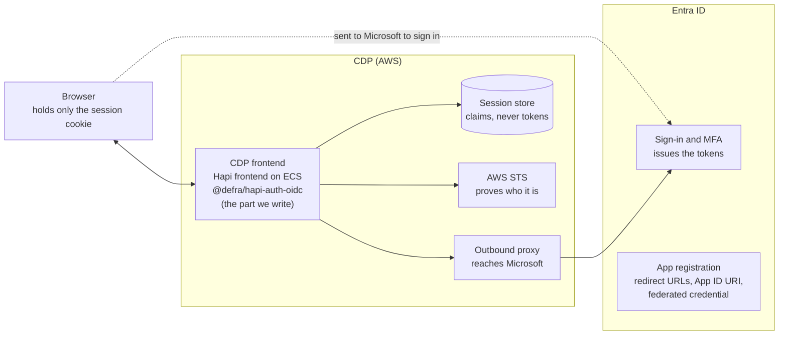
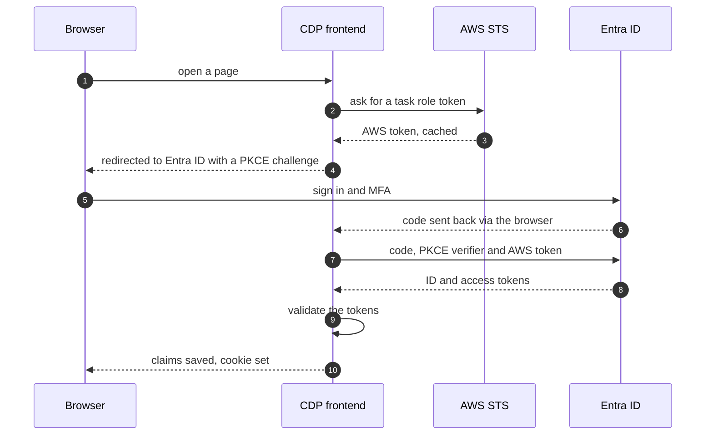

# Entra ID sign-in on a CDP frontend: high-level design

This is the design for AMCR-662 and answers its ten spike questions: the design for Entra ID sign-in on a CDP frontend (Q1), the code to build it from (Q2), how the service proves its identity to Entra ID (Q3), which environments need real Entra ID and what each needs (Q4 to Q8), and the design document and demo themselves (Q9, Q10). Regulators sign in with Defra's Entra ID using the authorization code flow with PKCE, and on CDP the service proves who it is with a federated credential from AWS instead of a client secret.

The proof-of-concept service from AMCR-671 is `epr-regulator-login-poc-frontend`; its `main` branch has the sign-in code (merged from `elsp-486-entra-claims-poc`). It is deployed to CDP dev, where sign-in against `defradev` is confirmed working. App roles appear here only so test users can be given one (Q8). Who gets access in production, and how it is removed, belongs to AMCR-540 Q5 and AMCR-541.

## Spike questions at a glance

| #   | Question                                                                 | Answer                                                                                                                                                                                                                               | Section                                 |
| --- | ------------------------------------------------------------------------ | ------------------------------------------------------------------------------------------------------------------------------------------------------------------------------------------------------------------------------------ | --------------------------------------- |
| Q1  | What is the design: components, sign-in flow, where configuration lives? | A Hapi frontend using `@defra/hapi-auth-oidc`, the authorization code flow with PKCE, and a server-side session that holds claims only. Configuration is split between CDP app config, CDP secrets and the Entra ID app registration | Components, Sign-in flow, Configuration |
| Q2  | Which existing code do we build from?                                    | `@defra/hapi-auth-oidc`, following `waste-disposal-fee-frontend`                                                                                                                                                                     | Decisions                               |
| Q3  | Client secret or federated credential?                                   | A federated credential on CDP; a client secret only for local development                                                                                                                                                            | Decisions                               |
| Q4  | Which environments need real Entra ID for the proof of concept?          | Local, dev and test                                                                                                                                                                                                                  | Environments                            |
| Q5  | Should dev use `defradev` or the stub?                                   | `defradev`. The stub stays for automated tests and offline local work (AMCR-594)                                                                                                                                                     | Environments                            |
| Q6  | What does each environment need?                                         | Its own app registration (local reuses dev's), a redirect URL pair, a federated credential on CDP, a session secret; proxy access is already in place                                                                                | What each environment needs             |
| Q7  | One `defradev` registration or one each?                                 | One each: dev, test and later perf-test each get their own `defradev` registration, and local reuses dev's. Later, ext-test and prod each get their own in the `Defra` tenant                                                        | One registration per environment        |
| Q8  | How are `defradev` test users created and given app roles, and by whom?  | Proposed: CCOE creates the users and a test group; the group is assigned to the app role; testers are added to the group. To confirm with CCOE                                                                                       | Test users and app roles                |
| Q9  | Is there a living design document?                                       | This document. It still needs moving to Confluence and linking from AMCR-498                                                                                                                                                         | Design document and demo                |
| Q10 | Has the design been shown to the team and agreed?                        | Not yet                                                                                                                                                                                                                              | Design document and demo                |

## Decisions

### Q2: build on `@defra/hapi-auth-oidc`

Use CDP's `@defra/hapi-auth-oidc` library (version 0.6.1 in the proof of concept). It runs the sign-in flow, PKCE and token checks, and supports a federated credential through its `WebIdentityTokenProvider`. `waste-disposal-fee-frontend` already uses it with a federated credential on CDP, so it is the reference app.

| Candidate                                                    | Decision                                                                                               |
| ------------------------------------------------------------ | ------------------------------------------------------------------------------------------------------ |
| `@defra/hapi-auth-oidc` (CDP)                                | **Chosen.** Supports a federated credential (AWS STS) on CDP and a client secret for local development |
| `@defra/hapi-oidc-auth` (pesticides team)                    | Not chosen. Client secret only: no AWS STS or federated credential support                             |
| `epr-frontend` `src/server/auth/plugins/entra-id.js` (Re-Ex) | Not chosen. Re-Ex's own code, not a shared library, and it uses a client secret                        |

> **Watch the names.** `@defra/hapi-auth-oidc` and `@defra/hapi-oidc-auth` differ only in word order and are easily confused. Only the first uses AWS STS: version 0.6.1 depends on `@aws-sdk/client-sts` and calls `GetWebIdentityToken` in `src/providers/web-identity.js`. `@defra/hapi-oidc-auth` 0.4.0 has no AWS dependency and requires a `clientSecret`. Always write the full package name.

### Q3: a federated credential, not a client secret

On CDP the service asks AWS STS for a short-lived token for its ECS task role and sends it to Entra ID as `client_assertion` in place of a client secret. Entra ID trusts the token because the app registration holds a federated credential that names the STS issuer, the task role ARN and an agreed audience.

- **Why:** a client secret expires and has to be rotated; Re-Ex's production secret expired on 07/11/2026. A federated credential leaves nothing to store or rotate, and Microsoft recommends it.
- **Every CDP environment uses it,** including dev, test and perf-test, which sign in against the `defradev` tenant.
- **Local development only** uses a short-lived client secret on dev's `defradev` registration, because a laptop has no AWS task role. It never goes into CDP.
- **The AWS side is already in place:** CDP has set up outbound identity federation, the `sts:GetWebIdentityToken` permission and the proxy allow-list globally, so nothing needs requesting.

## At a glance

The frontend is the only part we write. It reaches Entra ID through the CDP outbound proxy, and proves who it is with a token from AWS STS (the Q3 decision) instead of a stored secret.

## Components

Seven parts work together; only the frontend is code we write.

| Component           | What it is                                                                                                                | What it does in sign-in                                                                                                 |
| ------------------- | ------------------------------------------------------------------------------------------------------------------------- | ----------------------------------------------------------------------------------------------------------------------- |
| Regulator's browser | The regulator's own browser                                                                                               | Follows redirects between the frontend and Entra ID; holds only a session cookie, never tokens                          |
| CDP frontend        | A Hapi app on AWS ECS Fargate (in the proof of concept, `epr-regulator-login-poc-frontend`) using `@defra/hapi-auth-oidc` | Starts sign-in, receives the code back, exchanges it for tokens, checks them and keeps the user's claims in the session |
| Session store       | `@hapi/yar`, always stored server-side: Redis on CDP, memory locally                                                      | Keeps the user's claims between page loads; the tokens themselves are never stored                                      |
| Entra ID            | Defra's identity service: the `Defra` tenant for ext-test and prod, `defradev` for local, dev, test and perf-test         | Signs the regulator in (including MFA), then issues an ID token and an access token                                     |
| App registration    | Entra ID's record of the service                                                                                          | Holds the client ID, the allowed redirect URLs, the Application ID URI and the federated credential                     |
| AWS STS             | AWS's token service, called with the ECS task role                                                                        | Gives the frontend a short-lived token that proves which service it is, so no client secret is needed                   |
| CDP outbound proxy  | CDP's egress proxy                                                                                                        | Lets the frontend reach `login.microsoftonline.com` and AWS STS; already allowed globally by CDP                        |

## Sign-in flow

The frontend fetches the AWS token when sign-in starts and caches it, then sends it in place of a client secret when it exchanges the code (steps 5 and 6 in the next section).

## How sign-in works, step by step

A regulator is signed in after nine steps. The only one they see is the Microsoft sign-in page.

1. **The regulator opens a page that needs sign-in.** The frontend finds no session and starts sign-in.
2. **The frontend sends the browser to Entra ID.** The request carries the client ID, the return address `/signin-oidc`, the scopes it wants, and a one-time PKCE challenge, state and nonce that tie the reply to this request.
3. **The regulator signs in at Microsoft.** They enter their Defra account and complete MFA. If they are already signed in to Defra services, this step may pass without a prompt.
4. **Entra ID sends the browser back.** It returns to `/signin-oidc` with a one-time code and the state from step 2.
5. **The frontend proves who it is.** It gets a short-lived token from AWS STS for its ECS task role, which takes the place of a client secret (Q3). The library fetches it when sign-in starts and caches it, so it is ready here.
6. **The frontend exchanges the code for tokens.** Through the CDP outbound proxy it sends Entra ID the code, the PKCE verifier and the STS token. Entra ID checks the STS token against the federated credential on the app registration: the issuer, task role ARN and audience must all match.
7. **Entra ID returns an ID token and an access token.** The ID token says who the regulator is. The access token is issued for the service's own API scope, `api://<client id>/.default`.
8. **The frontend checks the tokens.** The library verifies the ID token's signature, issuer, audience, expiry and nonce. The frontend then reads the user's claims, such as `oid`, name and email.
9. **The regulator is signed in.** The frontend keeps only the claims in the server-side session, discards the tokens, and gives the browser a session cookie.

Locally the same flow runs against `defradev`, except that step 5 uses a short-lived client secret (`ENTRA_ID_CREDENTIAL_TYPE=secret`), because a laptop has no AWS task role. It uses dev's registration, which only allows `https` redirect URLs, so run the app with `npm run dev:https`: it puts an HTTPS proxy on port 3000 in front of the app on port 3001.

## Sign-out and session expiry

Both follow from the session set up at sign-in: signing out ends it and the Microsoft session, and expiry ends it after a fixed time.

### Signing out

1. The regulator clicks Sign out, which goes to `/logout`.
2. The frontend deletes the server-side session and clears the cookie.
3. The frontend sends the browser to Entra ID's sign-out page, so the Microsoft session ends too.
4. Entra ID returns the browser to `/signed-out`, an open page that confirms they are signed out. This address must be registered on the app registration.

Pages still on Azure use B2C, so signing out of CDP does not sign the regulator out of them. That is already a known problem under B2C (AMCR-545, AMCR-546) and is out of scope here.

### When the session expires

1. The session lasts for its configured time limit, 4 hours by default.
2. After that, the next page that needs sign-in starts sign-in again. If the regulator's Microsoft session is still active, they may not need to enter a password.

Tokens are not refreshed, because none are kept. A service that later calls an API with the access token will need to store and refresh tokens, and the tenants would then need to allow refresh tokens for the app.

## Where each piece of configuration lives

We control the first three rows. The app registration is a set of requests to CCOE, which take weeks. The AWS side is already set up globally by CDP.

| What                                                                                                                                                                 | Where it lives                                                      | Who changes it                          |
| -------------------------------------------------------------------------------------------------------------------------------------------------------------------- | ------------------------------------------------------------------- | --------------------------------------- |
| `ENTRA_ID_AUTHORITY` (holds the tenant ID), `ENTRA_ID_CLIENT_ID`, `ENTRA_ID_API_SCOPE`, `ENTRA_ID_CREDENTIAL_TYPE`, `FEDERATED_CREDENTIALS_AUDIENCE`, `APP_BASE_URL` | CDP app config, one set per environment                             | Us                                      |
| Session cookie password (`SESSION_COOKIE_PASSWORD`)                                                                                                                  | CDP secrets, per environment                                        | Us                                      |
| Client secret for local development (`ENTRA_ID_CLIENT_SECRET`)                                                                                                       | A developer's local environment file, `defradev` only, never in CDP | Us                                      |
| Redirect URL `/signin-oidc`, sign-out return `/signed-out`, access token version 2, Application ID URI, federated credential                                         | Entra ID app registration, one per environment                      | Entra team, through ServiceNow requests |
| ECS task role, `sts:GetWebIdentityToken` permission, outbound identity federation                                                                                    | The CDP AWS account for each environment                            | Already set up globally by CDP          |
| `login.microsoftonline.com` and AWS STS allowed out                                                                                                                  | CDP outbound proxy                                                  | Already set up globally by CDP          |

The audience must be the same in `FEDERATED_CREDENTIALS_AUDIENCE` and on the federated credential. The redirect URLs are built from `APP_BASE_URL` and matched exactly. A typo in either breaks sign-in. `ENTRA_ID_API_SCOPE` needs the Application ID URI to be set on the registration: without it Entra ID rejects sign-in, and with `ENTRA_ID_API_SCOPE` left empty sign-in works but no roles appear.

## Environments (Q4 and Q5)

| Environment | Tenant                    | Real Entra ID for the proof of concept?                                     | How the service proves its identity                                     |
| ----------- | ------------------------- | --------------------------------------------------------------------------- | ----------------------------------------------------------------------- |
| Local       | `defradev`                | **Yes.** Developers build and debug against it                              | Client secret in a local `.env` file                                    |
| dev         | `defradev` (not the stub) | **Yes.** The first CDP environment, where it is developed and shown working | Federated credential                                                    |
| test        | `defradev`                | **Yes.** Where testers and the wider team see it working                    | Federated credential                                                    |
| perf-test   | `defradev`                | Not for the proof of concept                                                | Federated credential, when needed                                       |
| ext-test    | `Defra`                   | Not for the proof of concept                                                | Federated credential; registration by change request, which takes weeks |
| prod        | `Defra`                   | Not for the proof of concept                                                | As ext-test                                                             |

**Q4: local, dev and test need real Entra ID.** Local is where the sign-in is built. dev and test run on CDP, so they are where the federated credential and the proxy are proved, and where other people can see it working.

**Q5: dev uses `defradev`, not the stub.** AMCR-592 took Re-Ex's mapping, which puts dev on a stub, but CDP does not require one:

- CDP's docs use a stub in dev for Defra ID only, and CDP's proxy allows `login.microsoftonline.com` in every environment.
- Re-Ex's page gives no reason for its dev stub, and its `defradev` registration lists a dev callback anyway. FCP Single Front Door uses a real `defradev` registration in dev.
- With a stub in dev, the federated credential and the proxy would first be tried in test.

The stub (AMCR-594) stays for automated tests, and for local work where a developer cannot reach `defradev`.

## What each environment needs (Q6)

| Need             | Local                                                                                          | dev                                                                                                                                | test                                                                                              |
| ---------------- | ---------------------------------------------------------------------------------------------- | ---------------------------------------------------------------------------------------------------------------------------------- | ------------------------------------------------------------------------------------------------- |
| App registration | Dev's registration (Q7)                                                                        | Its own `defradev` registration                                                                                                    | Its own `defradev` registration                                                                   |
| Redirect URLs    | `https://localhost:3000/signin-oidc` and `/signed-out`                                         | `https://epr-regulator-login-poc-frontend.dev.cdp-int.defra.cloud/signin-oidc` and `/signed-out`                                   | `https://epr-regulator-login-poc-frontend.test.cdp-int.defra.cloud/signin-oidc` and `/signed-out` |
| Proving identity | Client secret                                                                                  | Federated credential for the dev task role                                                                                         | Federated credential for the test task role                                                       |
| Secrets          | `ENTRA_ID_CLIENT_SECRET` and `SESSION_COOKIE_PASSWORD` in a local `.env` file, never committed | `SESSION_COOKIE_PASSWORD` in CDP secrets; no client secret                                                                         | Same as dev                                                                                       |
| Proxy access     | None needed                                                                                    | `login.microsoftonline.com` and AWS STS, already allowed by CDP                                                                    | Same as dev                                                                                       |
| App config       | Local `.env` file                                                                              | CDP app config: `ENTRA_ID_AUTHORITY`, `ENTRA_ID_CLIENT_ID`, `ENTRA_ID_API_SCOPE`, `FEDERATED_CREDENTIALS_AUDIENCE`, `APP_BASE_URL` | Same as dev, with test values                                                                     |

The hostnames follow CDP's `<service>.<env>.cdp-int.defra.cloud` pattern; check each one on the CDP portal before raising the request. If the federated credential cannot be made to work in an environment, the fallback is a client secret held in that environment's CDP secrets, never in code or config files.

## One registration per environment (Q7)

**Each CDP environment gets its own app registration.** Dev and test each have their own registration in `defradev`, and perf-test gets one when it needs it. Local development reuses dev's registration, with localhost redirect URLs and a short-lived client secret added to it.

- **Why one each:** a change or mistake on one registration cannot break another environment. Each environment has its own client ID, owners, app role assignments and federated credential, and the names follow CDP's `<service>-<env>` pattern.
- **The trade-off:** more ServiceNow requests, and the test app role and test group assignment (Q8) have to be set up on each registration.
- **Not Re-Ex's registration:** the existing `defradev` registration `epr-frontend` (7f81293c…) belongs to Re-Ex, so the proof of concept gets its own.
- **The `Defra` tenant** gives ext-test and prod a registration each later, through change requests that take weeks. Production then has its own client ID, app roles, owners and users, and a change made for testing cannot break it.

| Environment | Tenant     | Registration                                    | When                                        |
| ----------- | ---------- | ----------------------------------------------- | ------------------------------------------- |
| Local       | `defradev` | Dev's registration                              | Now                                         |
| dev         | `defradev` | `cdp-epr-regulator-login-poc-frontend-defradev` | Now, RITM1491038                            |
| test        | `defradev` | `cdp-<service>-test`                            | Next, one ServiceNow request                |
| perf-test   | `defradev` | `cdp-<service>-perf-test`                       | When needed                                 |
| ext-test    | `Defra`    | `cdp-<service>-ext-test`                        | Later, by change request; confirm with CCOE |
| prod        | `Defra`    | `cdp-<service>-prod`                            | Later, by change request; confirm with CCOE |

Each registration has its own client ID, so `ENTRA_ID_CLIENT_ID`, `ENTRA_ID_AUTHORITY` and `ENTRA_ID_API_SCOPE` in CDP app config differ by environment.

## Test users and app roles (Q8)

This is a proposal to confirm with CCOE, who own `defradev`:

1. **Define a test app role** on each registration, through the app roles request (`03`).
2. **Create a `defradev` security group** for proof-of-concept testers, and assign it to that app role.
3. **Create test users**, or confirm that our existing `defradev` accounts can be used. Have at least one user in the group and one outside it, so both outcomes can be shown. The proof of concept does not check roles; it only lists them on `/claims`. A user in the group sees the role and a user outside it sees none. To block users outside the group at sign-in instead, ask CCOE to turn on **Assignment required** for the app.
4. **Add and remove testers through the group.** Ask whether one of us can own the group, so we can manage testers without a request each time.

Still to find out: who in CCOE does this, through which request type, and how long it takes. Production access in the `Defra` tenant works the same way through Defra IT and MyPortal, and is covered by AMCR-540 Q5 and AMCR-541.

## Design document and demo (Q9 and Q10)

- **Q9, the living design document:** this document. A Markdown copy is in the proof-of-concept repo under `hld/` on `main`. The ticket asks for it to live on Confluence, so both teams can edit it and it outlives the proof-of-concept service, linked from AMCR-498. Each later ticket (AMCR-540, AMCR-594, AMCR-541) should update it.
- **Q10, demo and agreement:** not done yet. Present this design to the wider team and record the agreement on AMCR-662. The proof of concept's `main` branch already has the sign-in code, deployed to dev and confirmed working, so the demo can show the design working.

## Open points

Sign-in is confirmed working on CDP dev against `defradev`. These points still need settling before AMCR-544 builds on it.

- [x] Sign in against `defradev` on CDP dev. This also proves Entra ID accepts the AWS STS token.
- [ ] Run a real sign-in locally and on CDP test.
- [ ] Agree the app registration names with CCOE, and which request type creates a new registration in `defradev`.
- [ ] Name the backend API scope, if the frontend will call a backend, and make sure the backend accepts Entra ID access tokens.
- [ ] Keep the `/claims` debug page out of production, because it shows personal data.
- [ ] Confirm with CCOE who creates `defradev` test users and groups, and assigns app roles (Q8).
- [ ] Move this document to Confluence and link it from AMCR-498 (Q9).
- [ ] Demo the design to the wider team and record the agreement on AMCR-662 (Q10).
- [ ] Raise and link follow-on tickets (AMCR-662 AC3), for example the remaining registration requests, test users and the Confluence move.

## Setting up the app registration

Once the service exists in CDP, its URL and task role exist too. We then gather the values below and raise ServiceNow requests with CCOE. For the proof of concept that means one `defradev` registration for dev (also used locally), already requested as RITM1491038, and one for test (Q7). Each further environment repeats these steps; ext-test and prod in the `Defra` tenant come later, the same way.

### Steps

1. **Create the service in CDP and deploy it** to each environment. This gives it a URL, an ECS task role and an STS issuer.
2. **Collect the values** in the table below for each environment.
3. **Raise the new app registration request** (`00`). It is not a standard change, so check the catalogue item with CCOE first.
4. **Get the tenant ID and client ID back** from CCOE.
5. **Raise the standard changes** against the new registration: federated credentials (`01`), redirect URIs (`02`), the test app role (`03`) and API permissions and scope (`04`).
6. **Put the returned values into CDP app config** (`ENTRA_ID_AUTHORITY`, `ENTRA_ID_CLIENT_ID`, `ENTRA_ID_API_SCOPE`, `FEDERATED_CREDENTIALS_AUDIENCE`, `APP_BASE_URL`), add `SESSION_COOKIE_PASSWORD` as a CDP secret, and redeploy.
7. **Test a real sign-in** locally, then on CDP dev and test.

Nothing is needed from the CDP platform team: outbound identity federation, `sts:GetWebIdentityToken` and the proxy allow-list are already set up globally.

### Values to give CCOE

| Request                   | Value                                                        | Example                                                                                                                                             | Where to get it                                                                                                               |
| ------------------------- | ------------------------------------------------------------ | --------------------------------------------------------------------------------------------------------------------------------------------------- | ----------------------------------------------------------------------------------------------------------------------------- |
| `00` new registration     | Registration name                                            | `cdp-<service>-test`                                                                                                                                | Our decision, one per environment, following CDP's `<service>-<env>` pattern; confirm with CCOE                               |
| `00` new registration     | Tenant                                                       | `defradev` (6f504113-6b64-43f2-ade9-242e05780007) for dev, test and perf-test; `Defra` (770a2450-0227-4c62-90c7-4e38537f1102) for ext-test and prod | The environment-to-tenant mapping (AMCR-592)                                                                                  |
| `00` new registration     | Account type and platform                                    | Single tenant, Web                                                                                                                                  | Fixed                                                                                                                         |
| `00` new registration     | Access token version                                         | `requestedAccessTokenVersion: 2`                                                                                                                    | Fixed; Re-Ex found it is needed                                                                                               |
| `00` new registration     | Application ID URI                                           | `api://<client id>`, set under **Expose an API**                                                                                                    | Fixed; CCOE fills in the client ID                                                                                            |
| `00` new registration     | Client secret                                                | None on CDP; one short-expiry secret on dev's registration for local development                                                                    | Our decision (Q3)                                                                                                             |
| `00` new registration     | Owners                                                       | Named people                                                                                                                                        | Our decision                                                                                                                  |
| `02` redirect URIs        | Sign-in redirect URL                                         | `https://<service>.<env>.cdp-int.defra.cloud/signin-oidc`                                                                                           | The service URL on the CDP portal, plus the route in the code                                                                 |
| `02` redirect URIs        | Sign-out return URL                                          | `https://<service>.<env>.cdp-int.defra.cloud/signed-out`                                                                                            | As above                                                                                                                      |
| `02` redirect URIs        | Local URLs (dev's registration only)                         | `https://localhost:<port>/signin-oidc` and `/signed-out`                                                                                            | The app's local port: 3000 in the proof of concept, served over HTTPS by `npm run dev:https`                                  |
| `01` federated credential | Issuer                                                       | `https://<id>.tokens.sts.global.api.aws`                                                                                                            | CDP, per AWS account; the proof of concept README says the service can read it as `CDP_JWT_ISSUER`                            |
| `01` federated credential | Subject type                                                 | Explicit subject identifier                                                                                                                         | Fixed                                                                                                                         |
| `01` federated credential | Subject value                                                | `arn:aws:iam::<account id>:role/<service name>`                                                                                                     | The service's ECS task role ARN, from CDP                                                                                     |
| `01` federated credential | Audience                                                     | `epr-regulator-login-poc-frontend`                                                                                                                  | Our decision; must equal `FEDERATED_CREDENTIALS_AUDIENCE`                                                                     |
| `01` federated credential | Credential name and description                              | `cdp-<service>-test`                                                                                                                                | Our decision, one per registration, named after its environment                                                               |
| `04` API permissions      | Microsoft Graph `User.Read` (delegated)                      |                                                                                                                                                     | Usually there by default on a new registration                                                                                |
| `04` API permissions      | Application ID URI, no custom scope                          | The app requests `api://<client id>/.default`; nothing needs adding under **Add a scope**                                                           | Needed so the access token is issued for the app's own API and carries `roles`. Without the Application ID URI, sign-in fails |
| `04` API permissions      | Backend API scopes                                           |                                                                                                                                                     | Only if the frontend calls a backend: ask the backend team                                                                    |
| `03` app roles            | Test app role: value, display name, member type Users/Groups | A role value we agree                                                                                                                               | Our decision (Q8)                                                                                                             |
| `03` app roles            | Group assigned to the role                                   | A `defradev` test group                                                                                                                             | Created by CCOE (Q8)                                                                                                          |
| `03` app roles            | Assignment required (enterprise application)                 | `Yes`, if users outside the test group should be blocked at sign-in                                                                                 | Our decision (Q8)                                                                                                             |

> The part of the issuer before `.tokens` is an ID, not the AWS account number. Ask CDP for the issuer itself rather than building it from the account ID.

### Values CCOE gives back

| Value                                 | Where it goes                                                                                    |
| ------------------------------------- | ------------------------------------------------------------------------------------------------ |
| Tenant ID                             | `ENTRA_ID_AUTHORITY` = `https://login.microsoftonline.com/<tenant id>`, in CDP app config        |
| Client ID                             | `ENTRA_ID_CLIENT_ID`, and `ENTRA_ID_API_SCOPE` = `api://<client id>/.default`, in CDP app config |
| Local client secret (`defradev` only) | A developer's local `.env` file, never CDP                                                       |

The test app role (`03`) is there so test users can be given a role in the proof of concept (Q8). Who gets access in production, and how it is removed, is left to AMCR-540 Q5 and AMCR-541.
